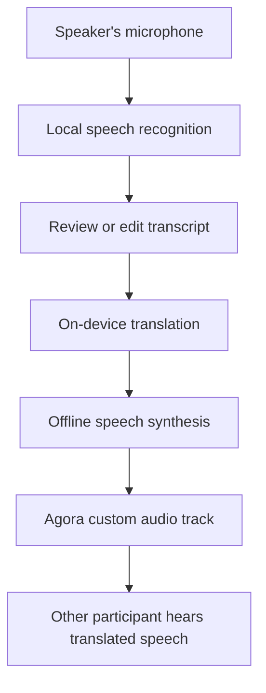

# Ninshu

Android video calling with on-device speech recognition, translation,
and synthesized voice transmission.

Ninshu helps people who speak different languages hold a conversation
while seeing each other on video. Each speaker’s phone recognizes their
speech, translates it locally, generates speech in the target language,
and transmits the resulting audio to the other participant.

## Status

Working prototype tested across two Android devices, including a
Pixel 3a XL running Android 11.

Implemented:

- Two-person video calling through Agora
- Bidirectional voice translation with per-device language configuration
- Android on-device speech recognition on supported devices
- Vosk offline recognition fallback for older devices
- ML Kit on-device text translation
- Offline Android text-to-speech
- Generated audio published through an Agora custom audio track
- Editable transcript review before sending
- Typed input as an alternative to speech
- Join, leave, and connection-status controls

The current conversation flow is turn-based. Users review recognized
text and explicitly select **Translate and Send**.

## How It Works



The same pipeline runs independently on both phones.

Video travels through Agora alongside the generated audio. Original
microphone speech is not published in the current translation mode.

## Technology

| Component | Implementation |
|---|---|
| Application | Kotlin, Jetpack Compose |
| Video and audio transport | Agora RTC SDK |
| Primary recognition | Android on-device SpeechRecognizer |
| Recognition fallback | Vosk |
| Translation | Google ML Kit |
| Speech synthesis | Android TextToSpeech |
| Async processing | Kotlin Coroutines and background executor |
| Configuration | Local Gradle properties exposed through BuildConfig |
| Minimum Android version | Android 11 / API 30 |

## Recognition Selection

Ninshu selects the recognition engine at runtime:

1. Use Android’s on-device recognizer on API 31+ when available.
2. Use Vosk when Android’s on-device recognizer is unavailable.
3. Fall back to Vosk if Android reports the requested language as
   unsupported or unavailable.

The bundled Vosk model must match the configured source language.
Changing the speech locale does not change the Vosk model.

## Project Structure

```text
app/src/main/java/com/araut/ninshu/
├── MainActivity.kt
├── SpeechInputEngine.kt
├── AutoSpeechRecognizer.kt
├── OnDeviceSpeechRecognizer.kt
├── VoskSpeechRecognizer.kt
├── OnDeviceTranslator.kt
├── VoiceSpeechSender.kt
└── ui/theme/
```

| File | Responsibility |
|---|---|
| MainActivity | Call UI, permissions, and pipeline coordination |
| SpeechInputEngine | Common recognition interface |
| AutoSpeechRecognizer | Runtime recognition-engine selection |
| OnDeviceSpeechRecognizer | Android on-device recognition |
| VoskSpeechRecognizer | Model loading and offline microphone recognition |
| OnDeviceTranslator | Translation-model preparation and text translation |
| VoiceSpeechSender | Offline synthesis, PCM conversion, and audio publication |

## Getting Started

### Requirements

- Android Studio and the Android SDK required by the project
- Two physical Android devices running API 30 or later
- An Agora project with valid RTC tokens
- An installed offline TTS voice for each target language
- A matching Vosk model where fallback recognition is required

### 1. Clone and open

```bash
git clone https://github.com/araut/ninshu-android.git
cd ninshu-android
```

Open the repository root in Android Studio and sync Gradle.

### 2. Configure local properties

Add these values to the root `local.properties`, preserving the
existing `sdk.dir` entry:

```properties
AGORA_APP_ID=<your-agora-app-id>
AGORA_RTC_TOKEN=<temporary-rtc-token>
AGORA_UID=1001

TRANSLATION_SOURCE_LANGUAGE=<source-language-code>
TRANSLATION_TARGET_LANGUAGE=<target-language-code>
SPEECH_RECOGNITION_LANGUAGE=<source-speech-locale>

SPEECH_TEST_TEXT=<sentence-in-the-target-language>
VOSK_MODEL_ASSET=model-speech
```

Translation language codes and speech locales are separate settings.
For example, a translation code may be `en`, while the recognition
service may require a locale such as `en-US`.

Both phones use the same Agora App ID and channel, `ninshu-dev`,
with different UIDs. UID-specific tokens must match their respective
users.

Configure the second phone with the reverse translation direction.

These settings are compiled into the APK. Rebuild and reinstall after
changing them. Each installed APK retains its build-time configuration.

### 3. Install the Vosk model

Download the appropriate small model from:

https://alphacephei.com/vosk/models

Extract the complete model into:

```text
app/src/main/assets/model-speech/
├── am/
│   └── final.mdl
├── conf/
│   ├── model.conf
│   └── mfcc.conf
├── graph/
└── ...
```

Preserve all files supplied with the model. Avoid an additional nested
model directory.

The model is copied into app-private storage on first use. If replacing
model contents under the same asset-folder name, remove the previous
extracted copy so the app can load the replacement.

Downloaded model files are excluded from Git and must be obtained
separately.

### 4. Prepare offline voices

In each phone’s Android text-to-speech settings:

1. Select a TTS engine.
2. Download a voice for the configured target language.
3. Confirm the voice works offline.

Speech-recognition models, translation models, and TTS voices are
separate resources.

### 5. Run a conversation

1. Install the configured app on both phones.
2. Select **Prepare translation** over Wi-Fi.
3. Join the call using different UIDs.
4. Select **Start speaking**.
5. Speak a short sentence and select **Stop** if needed.
6. Review or edit the transcript.
7. Select **Translate and Send**.
8. Listen to the translated audio on the other phone.

Use headphones or separate rooms during testing to avoid acoustic
feedback.

## Local Processing and Connectivity

Speech recognition, translation, and speech synthesis run on the
device when the required engines and models are available.

Internet access is required for:

- Initial translation-model downloads
- Obtaining model or voice resources
- Agora video and audio communication

On-device processing does not make the remote call offline.
Agora transports call media; this project does not claim that local
inference alone provides end-to-end encryption.

## Credentials

`local.properties` is excluded from version control.

BuildConfig values are embedded in the APK and should not be treated
as secret storage. Temporary RTC tokens are used for development.
Do not put an Agora App Certificate in the Android application.

A production release needs server-issued, short-lived tokens and
token renewal.

## Current Limitations

- Manual, turn-based recognition and sending
- Languages configured per build
- Vosk fallback requires a matching bundled model
- Recognition support varies by device and installed service
- Translation accuracy varies with phrasing and recognition quality
- Foreground-only calls; backgrounding ends the current call
- Standard synthesized voices
- Basic PCM resampling and audio-frame pacing
- No published latency, battery, or translation-quality benchmarks yet

## Roadmap

### Phase 1 Improvements

- Simplify the conversation screen and keep video prominent
- Move development credentials out of the main call interface
- Improve model readiness and recovery messages
- Validate repeated turns, reconnects, and interrupted recognition
- Measure recognition, translation, synthesis, and transmission timing
- Document reproducible model setup

### Phase 2

- Explore voice preservation
- Reduce end-to-end translation delay
- Improve conversational turn handling

## Acknowledgments

Built with Agora, Google ML Kit, Android speech APIs, and Vosk.

Third-party SDKs and models retain their respective licenses and
attribution requirements. Preserve model license notices and follow
ML Kit translation attribution requirements.
